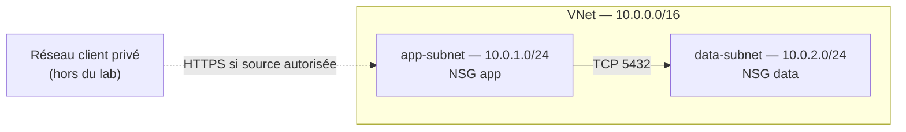

# Azure Secure Landing Zone

Petit lab réseau Azure écrit avec Terraform. Le but est de comprendre la segmentation entre une application et ses données, puis de vérifier les règles réseau avant un déploiement.

Le dépôt crée un Resource Group, un VNet, deux sous-réseaux et leurs NSG. Il ne déploie ni application ni base de données. Le nom « landing zone » désigne ici un socle réseau d'apprentissage, pas une landing zone Azure complète.

## Réseau



| Connexion initiée | Règle |
| --- | --- |
| Client privé → app, TCP 443 | Autorisée seulement si son CIDR figure dans `https_source_cidrs` |
| app → data, TCP 5432 | Autorisée dans les deux NSG |
| data → app | Refusée |
| SSH, RDP et autres flux entre machines | Refusés, y compris dans un même sous-réseau |
| Sortie vers Internet | Refusée ; accès sortant implicite désactivé |

Les refus ont la priorité 4096, avant les autorisations internes d'Azure (65000). Les NSG suivent l'état des connexions : une réponse à un flux autorisé ne nécessite pas de règle inverse. Les services de plateforme Azure, comme DNS et IMDS, ont des exceptions : voir la [documentation Microsoft](https://learn.microsoft.com/azure/virtual-network/network-security-groups-overview).

Par défaut, `https_source_cidrs = []` : aucun accès entrant sur app. Ajouter un CIDR ne crée pas de VPN ni de peering. Le port 5432 représente un exemple PostgreSQL, sans installer PostgreSQL.

## Vérifier en local

Prérequis : Git et Terraform 1.7 ou plus (1.x). La CI utilise Terraform 1.14.4 et le provider AzureRM est verrouillé dans `.terraform.lock.hcl`.

```sh
git clone https://github.com/zakaryks/azure-secure-landing-zone.git
cd azure-secure-landing-zone
terraform init -backend=false -lockfile=readonly
terraform fmt -check -recursive
terraform validate
terraform test
```

Ces tests utilisent un provider Azure simulé : aucun compte Azure ni ressource facturée. Ils vérifient les flux permis, les refus, les associations et les entrées invalides. Ils ne prouvent pas le passage réel de paquets.

GitHub Actions exécute ces contrôles et un scan Trivy qui échoue sur les problèmes HIGH ou CRITICAL. Pour reproduire le scan avec Trivy 0.75.0 :

```sh
trivy config --disable-telemetry --skip-version-check --severity HIGH,CRITICAL --exit-code 1 --skip-dirs .terraform .
```

## Déployer sur Azure

Il faut Azure CLI, un abonnement de test et les droits de création du groupe et de ses ressources réseau. Le fournisseur `Microsoft.Network` doit être enregistré dans l'abonnement. Si nécessaire, un administrateur peut lancer `az provider register --namespace Microsoft.Network --wait`.

1. Copier `terraform.tfvars.example` vers `terraform.tfvars` et adapter les valeurs. `vnet_cidr` accepte un réseau privé /16 ; les deux /24 sont calculés pour éviter les chevauchements.
2. Se connecter et sélectionner l'abonnement :

```sh
az login
az account set --subscription "ID_DE_VOTRE_ABONNEMENT"
```

AzureRM 4 demande aussi cet ID dans l'environnement. Avec Bash :

```sh
export ARM_SUBSCRIPTION_ID="$(az account show --query id -o tsv)"
```

Avec PowerShell :

```powershell
$env:ARM_SUBSCRIPTION_ID = az account show --query id -o tsv
```

3. Lire le plan avant d'appliquer :

```sh
terraform init -lockfile=readonly
terraform plan -out=lab.tfplan
terraform apply lab.tfplan
terraform output
```

Un premier déploiement doit ajouter **8 ressources**. Suivre ensuite le [guide de vérification](docs/verification.md), notamment le second plan sans changement. Aucun déploiement réel n'est revendiqué par les tests de ce dépôt.

Pour supprimer le lab après usage, vérifier les ressources annoncées par `terraform plan -destroy`, puis lancer `terraform destroy` et confirmer. Retirer d'abord les éventuelles machines ajoutées aux sous-réseaux.

## État, coûts et limites

- Le state reste local pour ce lab individuel. Garder une sauvegarde protégée ; ne jamais committer les states, plans ou fichiers de variables personnels. En équipe, utiliser un [backend Azure Blob avec authentification Entra ID et verrouillage](https://developer.hashicorp.com/terraform/language/backend/azurerm).
- Aucune VM, passerelle VPN, NAT Gateway ou Azure Firewall n'est créée. Le VNet est [sans coût propre](https://azure.microsoft.com/pricing/details/virtual-network/) ; les machines, passerelles ou peerings ajoutés au lab peuvent être facturés.
- Les sorties sont fermées : installer des paquets ou joindre un service externe demande une règle et une connectivité adaptées. Il n'y a pas d'inspection du contenu HTTPS, de journalisation des flux, de gouvernance multi-abonnements ni de haute disponibilité applicative.
- Si l'ancienne version est déjà déployée, lire les [notes de mise à jour](docs/verification.md#depuis-la-première-version) : les nouvelles règles resserrent les accès.

Le code reste à la racine : `main.tf` pour le réseau, `security.tf` pour les NSG, `variables.tf` et `outputs.tf` pour les paramètres et résultats. Pas de module séparé tant qu'il n'y a qu'un seul lab à maintenir.
